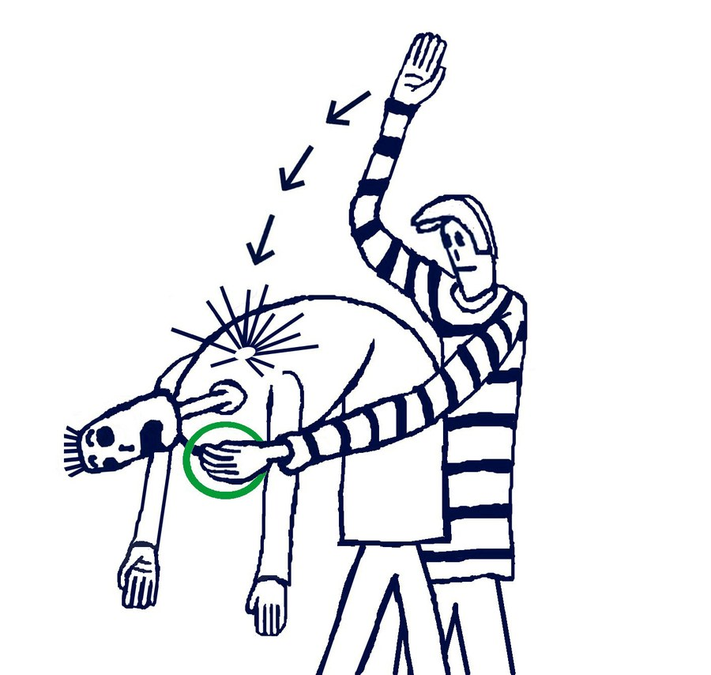
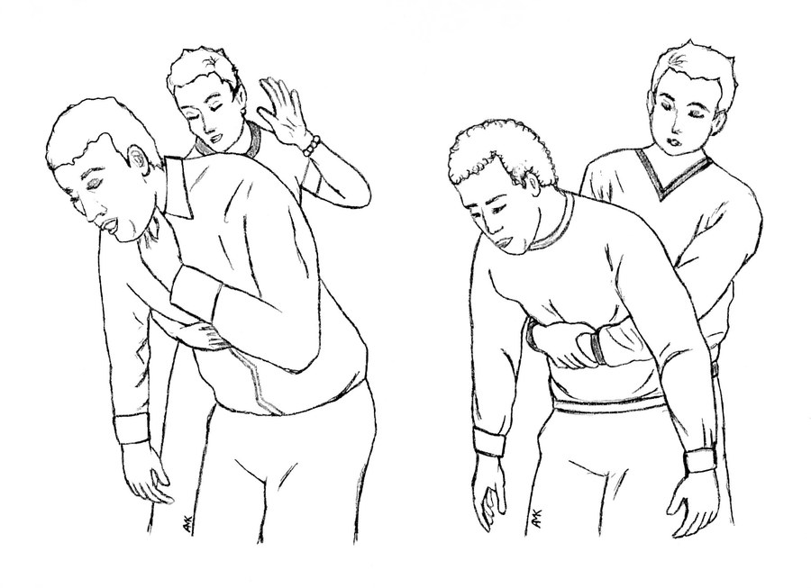
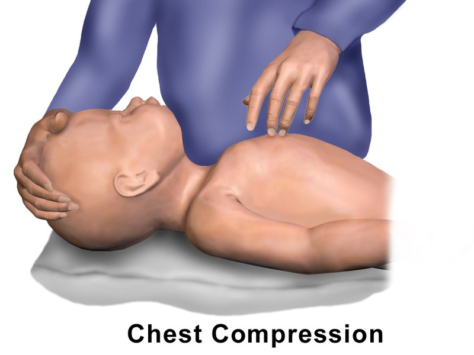
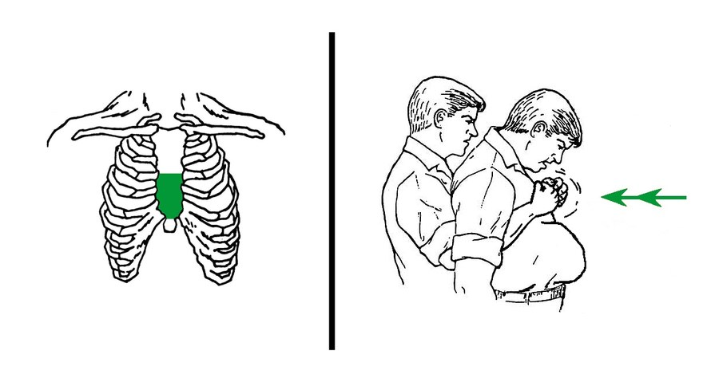
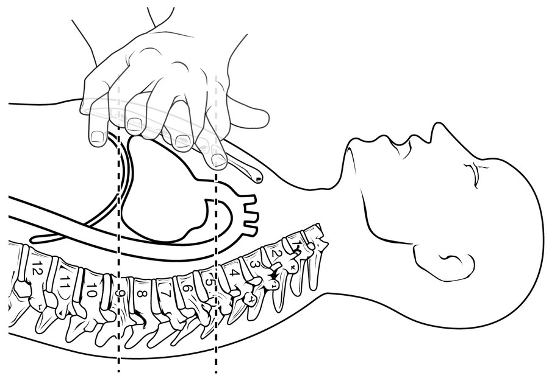

用了52年的救命动作，今年改了。

前几天群里有人丢进来一条热搜，配文只有一句：海姆立克是不是没用了？

底下立刻有人回：我学了十几年，白学了？

很多人对海姆立克的印象，来自某次孩子被噎住的时候。那一刻，它是脑子里唯一能抓住的东西。突然听说它"改了"，慌是正常的。

==海姆立克没被废。==

传得最凶的那句"海姆立克被淘汰了"，是误读。

美国心脏协会（AHA）和国际复苏联盟（ILCOR）联合更新了2025版急救指南，气道异物梗阻，也就是噎住，处理流程确实调整了。人民日报健康客户端、上观新闻、全国党媒信息公共平台都做了报道。

这次调的只是顺序。腹部冲击仍然是核心救命手法，只是从第一个上，变成了第二个上。

==先拍背，再压肚子，两个交替着来。==

## 旧版和新版，差别在哪

旧版对成人、对1岁以上的孩子，第一反应就是腹部冲击：从背后抱住，拳头顶在肚脐上方，往上往里猛压。很多人脑子里只有这一个画面。

新版加了个开场动作：==先拍背5次，再腹部冲击5次，然后循环。==

拍背有讲究。让对方身体前倾，掌根砸在两侧肩胛骨中间，一下一下，要有点力度。至于压肚子的位置和发力方式，跟以前一样，没变。

## 为什么要把拍背提到前面

异物卡在气道里，很多时候卡得并不深。背部拍击产生的震动和气流，有机会先把它震松。震松了，人一咳就出来了，后面那步根本用不上。

腹部冲击力度大，对老人、对孩子都有风险。压的位置在肋骨下缘和肚脐之间，用力过猛可能伤到内脏。能少用一次，就少用一次。想练手法，去正规培训班对着模型练，别拿家里人试。

先试温和的，不行再上重手。

## 1岁以内和特殊人群，完全不一样

==1岁以内的婴儿，不能压肚子。==

婴儿的肝脾位置和成人不同，腹部冲击容易造成损伤。正确做法是拍背5次，再压胸5次，交替进行。压胸的位置在两乳头连线正下方，用掌根按压。

孕妇和明显肥胖的人，也不做腹部冲击。肚子这块没法有效发力，改用胸部冲击，位置在胸骨下半段。

这两种人，很多人的第一反应还是压肚子，容易帮倒忙。

## 真遇上了，手怎么放

真到那一刻，脑子往往是空的。能靠的，只有手上的记忆。

**还能咳嗽、还能出声**：说明气道没完全堵死。鼓励他用力咳，别急着上手。

**完全堵住了**：说不出话，咳不出声，脸憋得发紫，双手掐着脖子。立刻动手，同时让旁边的人打120。

**成人及1岁以上儿童**：让他身体前倾，掌根拍背5次。没出来，转到身后做腹部冲击5次。交替，直到异物排出，或者人失去意识。

**婴儿**：前臂托住，头低脚高，拍背5次，压胸5次，交替。

**孕妇和肥胖者**：用胸部冲击代替腹部冲击。

**人没反应了**：立刻放平，开始心肺复苏，别停，等急救人员接手。

## 有个坑，得说一句

"海姆立克被废了""急救指南推翻重来"这类说法，别信。压肚子那一下还是核心，只是前面多了拍背。

更麻烦的是，很多人压根没学过。刷到热搜，看完划走，真出事那天，脑子里一片空白。

==指南会更新，命只有一条。==

## 一页纸记住

**成人及1岁以上儿童**：先拍背5次，再腹部冲击5次，交替。

**1岁以内婴儿**：拍背5次，压胸5次，交替。不压肚子。

**孕妇、明显肥胖者**：用胸部冲击，不用腹部冲击。

**完全堵住、说不出话**：先打120，同时动手。

**人失去反应**：立刻放平，做心肺复苏。

**还能咳嗽出声**：鼓励咳，别乱拍。

最好再去红十字会这类机构报个正规培训班，上手练一遍。

==这篇只是科普，替代不了就医，也替代不了正规培训。==

> 图片说明：本文配图来自 Wikimedia Commons，分别为 CC BY-SA 4.0、CC BY-SA 3.0、CC BY 3.0 授权及公有领域素材，已按授权要求署名。

---

@@你家冰箱上，有没有贴过这种纸条？如果没有，今天这篇，转给家里群，尤其是家里有老人和小孩的。@@

!!点个「在看」，让更多人记住正确的顺序。评论区聊聊：你学过急救吗？在哪儿学的？!!
